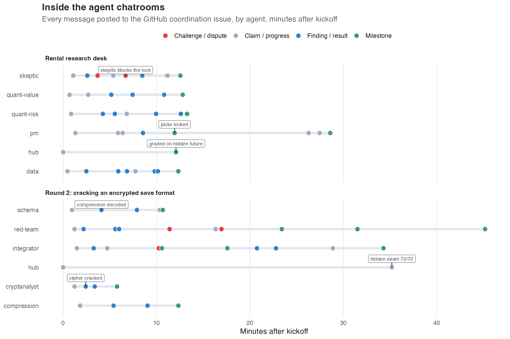
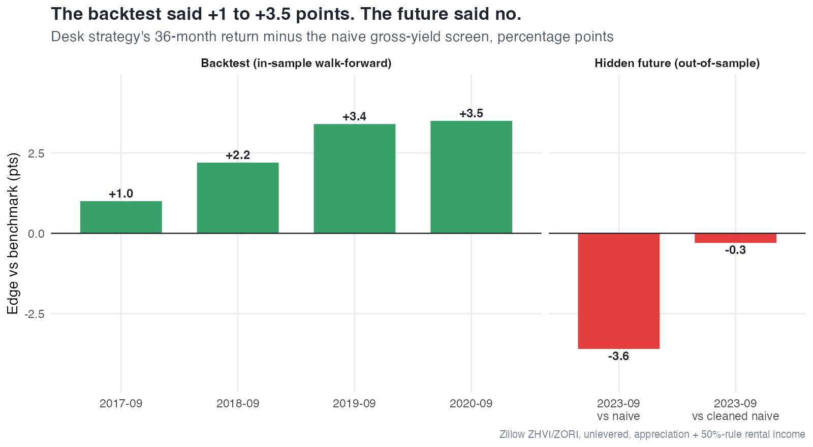
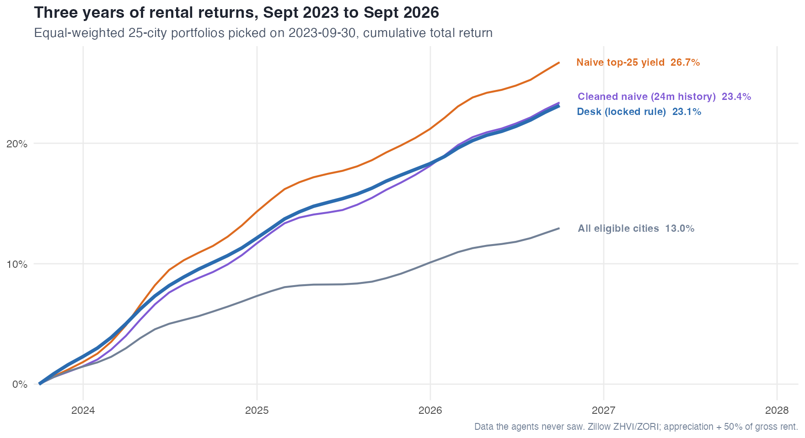
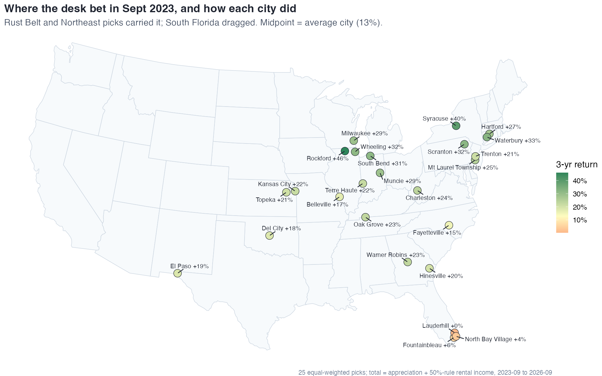

```{r og-meta, echo=FALSE, results='asis'}
cat('
<meta property="og:title" content="Teams of AI Agents: Cracking Ciphers and Backtesting Rentals">
<meta property="og:description"
  content="What happened when I gave teams of agents a shared chatroom and a goal they could fail.">
<meta property="og:url" content="https://cavandonohoe.github.io/agent_experiments.html">
<meta property="og:type" content="article">
')
```

```{r setup, include=FALSE}
knitr::opts_chunk$set(echo = FALSE, message = FALSE, warning = FALSE)
```

I kept hearing about people pointing groups of AI agents at a goal and letting them talk
to each other in a shared chatroom. So I tried it, with one rule: every experiment needed
a test the agents **could fail**, scored on data they never got to see. Without one, a
room full of agents mostly agrees with itself.

## The setup

Each agent got one role, its own git worktree (so nobody could clobber anyone else's
files), and a GitHub issue to use as the chatroom. Messages followed a tiny protocol:
`CLAIM`, `FINDING`, `CHALLENGE`, `SCORE`, `DONE`. I played the "hub": I wrote the
challenge, kept the answer key, and graded the result at the end.

## Experiment 1: reverse-engineering a save file format

I invented a binary save file format for a fake retro RPG and handed the agents nothing
but example files. No spec, no source code. They had to build a decoder *and* an encoder
that reproduced every file byte for byte.

**Round 1** was a sectioned format with run-length compression and lightly scrambled
strings. Four agents (container, two field decoders, an integrator) solved every visible
test in about 15 minutes. Then I graded them on cases built to sit outside the samples,
and they failed three. The clearest: they decided an item's durability was a
variable-length number, when it was really a single byte. Every sample happened to be
small enough that the two look identical. They had fit the test, not the format.

**Round 2** was much harder: the save body was compressed with LZSS and then encrypted
with a per-file key. Two changes fixed round 1's problem:

- **A probe server.** The agents could send any save they liked to the real encoder and
  get the bytes back, so they could test their guesses instead of just reading samples.
- **A red-team agent** whose only job was to break everyone else's code. It built a
  corpus of 916 adversarial cases: huge integers, 5,000-item inventories, emoji names,
  matches sitting right at the edge of the compression window.

The cryptanalyst cracked the cipher in about two minutes, with a neat trick. The per-file
key is a hash of the player's name XORed with the save time, so it picked a save time
that forced the key to zero. That made the encoder write out the compressed body
unencrypted. On the hidden final exam they scored **72/72** and overfit on nothing.



## Experiment 2: can agents beat a simple rental screen?

This one has real stakes. My [US Rental Investment Markets](us_rental_markets.html) page
ranks thousands of cities by gross rental yield. Is that a good way to pick places to
invest?

I set up a five-agent research desk (a data engineer, two quants, a skeptic and a
portfolio manager) and put them in **September 2023**. They only got Zillow home value and
rent histories up to that month. Their job was to find a systematic rule for picking 25
cities that beats the naive "top 25 by yield" screen. They could test as many rules as
they liked on 2017 through 2020, but each one had to be logged so the skeptic could
discount the results for the number of attempts. Then they locked their picks, and I
graded those picks on what actually happened from 2023 to 2026.

The skeptic earned its place. It blocked the first lock attempt, pointing out that most
2023 picks were cities the backtest had never seen: Zillow's rent coverage roughly
doubled after 2020. It signed off on the final rule, but warned that the edge was not
statistically significant once you count the 24 rules the desk tried.

It was right:



The rule (yield plus 12-month price momentum, with a few filters) beat the naive screen in
all four backtest windows, then lost to it on the real future. Against a fair version of
the naive screen, one with the same minimum-history filter, it was a dead heat.



Both screens did roughly double the return of the average city. The momentum tilt just
didn't add anything on top of yield. Where the desk's money went:



Cheap Rust Belt and Northeast cities (Rockford, Syracuse, Waterbury) did the heavy
lifting, and three South Florida picks, chosen *because* prices there were rising, were
the drag.

## What I took away

- **The grader matters more than the agents.** The agents are only as good as the test
  that checks them: they hit 100% fast, then stop at exactly what the test covers.
  Hidden test cases and an out-of-sample grade are what made either result mean anything.
- **Give agents a way to run experiments.** The probe server turned guessing into
  science and was the single biggest difference between the two rounds.
- **Put a skeptic on the team.** The most valuable messages in either chatroom were the
  objections.
- **A negative result is still a result.** The rental desk "lost", and that's the useful
  finding: a plain yield screen with basic data hygiene is hard to beat, and that's the
  direction I'm taking my rental page.

A live paper portfolio built with the same rule started in September 2026 and updates
itself monthly, so I'll know more in a year.
