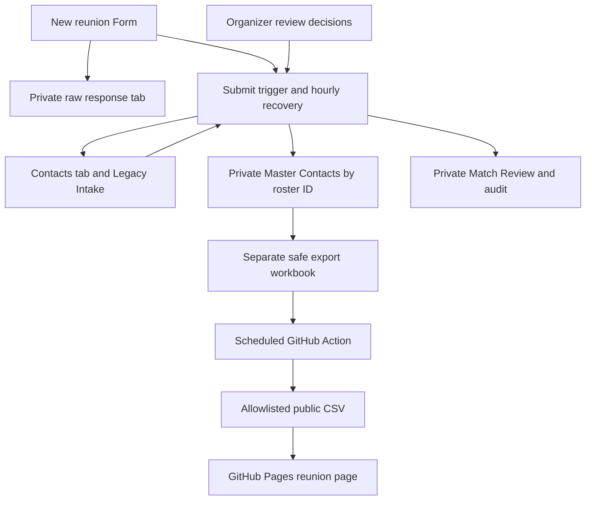

# TOHS reunion contact workflow

## Current rollout status

The new Form is installed and published, with a native response tab, submission
trigger and an hourly recovery trigger. The private workbook now uses the
editable `Contacts` mode described below.
The production website remains on the old workflow until PR 206 is reviewed and
merged. No legacy data or old Form has been replaced or deleted.

[New contact Form](https://docs.google.com/forms/d/e/1FAIpQLSf6ooQrcPNEJI9DnVKlxtksYhhZtNEXHTzBNcalMiRgSRHHnw/viewform).
[Separate safe export workbook](https://docs.google.com/spreadsheets/d/1-LqsItnKUbSvGhMqMMKmHg-IkMk3uonioNJHD95st58/edit)
contains only the four public fields and is shared read-only with the existing
GitHub service account. It was created from sanitized data, with no contact data
in its version history. The private workbook is owner-only.

The original [TOHS Class of 2012 workbook](https://docs.google.com/spreadsheets/d/1JwWeBjwwQHzmGgh8HPuO_0pghzemC3ikpLx_pXlQvsI/edit)
remains authoritative for the graduation roster and manual legacy contact edits.
The [private staging workbook](https://docs.google.com/spreadsheets/d/14WancXKUFazrPQPz09vSQve0Ae9jroSAufHhbYNrJYw/edit)
contains a complete native copy of all three legacy tabs plus the V2 derived views.
Its sharing was verified as owner-only when created. Those copied legacy tabs are
a preservation snapshot; the script reads the original workbook each refresh.

At staging: 574 unique graduates, 218 nonblank master emails, 219 emails in the
derived view after conservative legacy reconciliation, and 60 legacy submissions
needing identity/field review. Original data is preserved regardless of a match.
These counts are a point-in-time check, not hardcoded workflow inputs.

## Data flow

The Form collects graduation first/last names, preferred/full name, email,
and optional phone number. First name, last name and email are required.
The two interest questions were removed at the owner's request; historical answers
remain in the preserved legacy tabs and private master. Respondent summaries and
response editing are disabled.
The Form description explains which fields appear publicly.

Google stores native raw responses in a newly linked response tab in the staging
workbook. `refreshContactWorkflow()` rereads Form responses by stable Google
response ID and also reads rows added directly to that linked response tab.
The sheet is identified by its Form link, so renaming the tab does not break intake.
Rows identical to native responses retain the native response ID and its review
decision. Sheet-only rows receive stable content hashes scoped to the sheet ID;
reordering rows does not change their IDs. Editing a row creates a new input for
the existing conservative reconciliation policy. Partial or invalid entries go
to the private review queue rather than disappearing.

Before any generated output is written, every distinct input must have an audit
outcome and every unresolved outcome must have a review entry. A missing or
ambiguous linked response sheet, changed schema or incomplete audit stops the
refresh. `Workflow Status` records native, sheet-only and audited submission counts.
The existing hourly trigger recovers failed submission triggers and API/manual
sheet writes, which do not necessarily fire a native Form submission trigger.
It never deletes or rewrites native responses, the original workbook, or its copied
legacy tabs. Only script-owned generated views are rebuilt.

### Response-sheet ingestion rollout

The repository fix must also be installed in the existing **TOHS 2012 Contact
Workflow** Apps Script project; merging a GitHub PR does not update that runtime.
Until installed and verified, use the original workbook's `Contact List (No-form)`
for organizer-entered contacts. Do not edit generated Master Contacts or exports.
After installation, run `refreshContactWorkflow()` and confirm that each supplied
contact is either accepted in Master Contacts or present in Match Review, with an
outcome in Match Audit. Confirm the separate safe export and deployed website too.
The regression suite covers a synthetic sheet-only entry, duplicate/native
response decisions, row reordering, partial/conflicting inputs and publication
refusal when an input is absent from the audit.

## Matching and merge policy

* The roster ID from `Full Grad Class` is the permanent person key. Never use row
  position or a legacy response sequence ID as a person key.
* Automatically match only one exact graduation first/last name after case,
  Unicode and whitespace normalization. If the email points to another person,
  require identity review. No fuzzy name or email-only merges.
* Duplicate/unmatched names and changed surnames require an organizer to select
  an existing roster ID. New submissions never add people to the graduation roster.
* Fill empty fields. Keep nonempty existing fields. Blank answers never erase data.
  Differing nonempty values are retained in the raw source and queued for review.
  Other nonconflicting empty fields can still be filled from that same submission.
* Process legacy submissions first, then new submissions in timestamp/response-ID
  order. Repeated delivery of the same response is applied once; a reused
  response ID with different content stops the refresh. In the original-workbook
  mode the immutable roster is the starting point of every run. In `Contacts`
  mode (below) the persisted Contacts tab is the starting point and each
  submission is applied to it only once.
* `Master Contacts` holds accepted contacts, interests, and field-source response
  IDs. `Match Audit` records match outcomes. Original contacts remain in their
  original cells even after an explicitly approved V2 replacement.

For a review, copy the response ID from `Match Review` into `Review Decisions`,
enter the verified `roster_id`, choose `Approve fill`, `Approve replacement`, or
`Reject`, and enter a reviewer note identifying who verified it and why. Then run
`refreshContactWorkflow()` or wait for the hourly run. `Approve fill` resolves
identity and fills empties; it does not replace conflicting fields. `Approve
replacement` explicitly accepts nonblank replacement values from that response.
Keep source IDs unchanged and unique; changing legacy source IDs invalidates any
decisions attached to them. Never edit generated Master Contacts directly.
`Reject` also undoes an earlier automatic fill from that response: fields whose
recorded source is the rejected response are cleared, unless an organizer has
since edited that value (the edit is kept).

## Contacts mode (editable roster)

When the private workbook has a `Contacts` tab, it replaces the original
workbook as the roster and `Legacy Intake` replaces the old legacy tabs.
Organizers edit Contacts directly; generated tabs remain read-only views.

* Every non-empty Contacts row must have a unique `Roster ID`. A row with data
  but no ID stops the refresh before anything is written. Add an ID first.
* Every non-empty `Legacy Intake` row must have a unique `response_id`; a
  missing or duplicate ID stops the refresh instead of dropping the row.
* `Field Sources` is script-owned JSON. Per field it records the response ID and
  the value applied (`{"email":{"id":"...","value":"..."}}`), and under
  `_applied` the responses already applied to that contact and at which level
  (`auto`, `Approve fill`, `Approve replacement`). A response is applied once per
  level. On later runs it is only checked for conflicts, so values an organizer
  edited or cleared are not restored by a replay, and an `Approve replacement`
  does not revert later manual edits. Older rows that list plain response IDs
  are treated as already applied for those responses.
* The script writes back by Roster ID, only to Roster ID through Contact Status,
  and only rows whose values changed. Alternate Email, Last Contacted, Last
  Verified, Contact Source and Notes are never written by the script.
* If Contacts changes while a refresh is running, that refresh writes no
  Contacts cells and fails; the next run picks up the edit.
* Adding or removing Roster IDs stops publication (`Contacts roster IDs
  changed`). If the change is intended, run `acceptContactsRosterChange()` once
  from the Apps Script editor; it refreshes and records the new ID set as the
  `Master Contacts` baseline. The public refresh still refuses roster drops
  above 20%.

## Privacy boundary and reliability

`Public Export` and `data/tohs_reunion.csv` contain exactly:

| Field | Meaning |
| --- | --- |
| `first_name` | Graduation roster first name |
| `last_name` | Graduation roster last name |
| `email_bool` | Whether the merged private contact has an email |
| `updated_at` | Public snapshot timestamp |

No emails, phones, preferred names, response IDs, individual interest answers,
review decisions, or raw responses are written to GitHub, logs, or build artifacts.
Unit tests use reserved example.invalid addresses only. The public CSV begins with
the conservatively reconciled roster coverage. The isolated synthetic preview test
temporarily used a safe test snapshot with a prominent TEST ONLY banner; both were
restored before review. The real contact records were never changed by the test.

The V2 Action reads only `Public Export`. It rejects unknown columns, malformed
coverage flags, unsafe names (including any digit), inconsistent timestamps,
export age over three hours,
and roster drops above 20%. Failed refreshes keep the last good public snapshot.
The website renderer only reads the checked-in snapshot and never bootstraps from
a private Sheet. A missing snapshot stops rendering.

The submit trigger refreshes the private views immediately. The hourly Google
trigger recovers missed events and applies reviews. The GitHub Action is
scheduled for minute 23 of each hour, but GitHub delays and drops scheduled runs
under load, so in practice runs land every few hours. Each run updates only the
allowlisted CSV/Form URL and requests a Pages build when the deployed data or
Form URL differs. It is not a real-time delivery guarantee.

The CSV `updated_at` (shown on the page as when the list "last changed") moves
only when the public rows change. It is the time of the last data change, not
the time of the last successful check.

Keep the entire contact workflow workbook private. GitHub has reader access only
to the separate export file, never the private response/master workbook. Google
permissions are file-wide; a safe tab inside a private workbook is insufficient.

## Installation and cutover

The installed Apps Script project is **TOHS 2012 Contact Workflow**. Its runtime
source corresponds to `scripts/tohs/contact_workflow.js`, with the test helper in
`scripts/tohs/acceptance_test.js`. Verify the three IDs before any reinstallation.
`installContactWorkflow()` reuses the stored Form ID and triggers on retry; it
publishes only after the linked destination and refresh succeed. Legacy rows with
no ID receive a stable SHA-256 content reference, never a roster person ID.

Merging PR 206 changes the website Form link and the Action source to the separate
safe export workbook. Those defaults are checked in; no repository variable is
required. Optional variables `TOHS_PUBLIC_SPREADSHEET_ID` and `TOHS_FORM_URL`
override them; never point the export variable at a private contact workbook.
CI validates the live service-account read on the PR without deploying production.
After merge, dispatch the reunion refresh on main and verify the Pages deployment.

The old Form, original roster, old contacts and historical responses remain
available. Roll back by reverting the PR and running the old refresh/deployment;
retain the new response workbook and Form data. Do not delete anything at cutover.

## Acceptance test

The acceptance test used one existing roster entry whose original email was
blank. No real updated email was supplied, so no contact value was invented or
written.

The local synthetic tests use fictional names and IDs only. They verify that a
submission resolves to a single roster ID, fills an empty email, increases
coverage by one, leaves the missing-email list consumed by the website, leaves
the input roster untouched, and exports no email address. They also check
conflicts, duplicates, ambiguous identity, rejection (including undoing an
auto-fill), replay onto a persisted Contacts tab, manual edit preservation,
ID-less rows, phone-like names, malformed values, and formula-like input.

An isolated browser acceptance run (separate **TEST ONLY** Form and response tab)
matched the expected roster ID, produced `email_bool = TRUE` in its isolated
outputs, and was verified on a PR preview. Production Master Contacts, the export
and the original workbook were not changed, and the final PR restored the real
snapshot. The test helper code contains only a reserved example.invalid address.

**Production acceptance still requires a real, verified contact update.** Submit
it, then confirm the roster ID in Contacts and Master Contacts, TRUE in the
separate export, and removal from the production missing list after the next
scheduled refresh.

Local checks: `node --test tests/tohs-contact-workflow.test.cjs`; R checks:
`Rscript -e 'testthat::test_file("tests/testthat/test-tohs_reunion.R", stop_on_failure=TRUE)'`.
The R checks and rendered website preview run in GitHub CI if R is unavailable locally.

Google API references: [Forms](https://developers.google.com/apps-script/reference/forms/form)
and [Form triggers](https://developers.google.com/apps-script/reference/script/form-trigger-builder).
