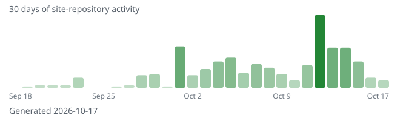

```{r structured-data, echo=FALSE, results='asis'}
cat('
<script type="application/ld+json">
{
  "@context": "https://schema.org",
  "@type": "Person",
  "name": "Cavan Donohoe",
  "jobTitle": "Data Scientist",
  "url": "https://cavandonohoe.github.io",
  "sameAs": [
    "https://github.com/cavandonohoe",
    "https://www.linkedin.com/in/cavan-donohoe/",
    "https://www.instagram.com/cavandonohoe",
    "https://www.facebook.com/cavandonohoe"
  ],
  "email": "cavandonohoe@gmail.com",
  "description": "Data Scientist passionate about making workflows easier through automation and reproducible analysis."
}
</script>
')
```

Welcome to my Website! It's all done in R and GitHub, so that's pretty cool. Most of the data
updates itself on a schedule too.


I thought it might be worth investing some time to make a website to point to an area of my life where it gets a little more professional. But then I thought, why *just* do that? Why not incorporate some other aspects of my life that makes me me. So yes, this will have my ever growing resume, but let's have a little bit of fun while we're here.

## Live Activity

```{r live-activity, echo=FALSE, results='asis'}
read_json_safe <- function(path) {
  if (!file.exists(path) || !requireNamespace("jsonlite", quietly = TRUE)) return(NULL)
  tryCatch(jsonlite::fromJSON(path, simplifyVector = FALSE), error = function(e) NULL)
}

lately <- read_json_safe("data/lately.json")
changelog <- read_json_safe("data/changelog.json")

# Shared by this chunk and home-year-review: a big number over a small label.
stat_html <- function(class, value, label) {
  paste0('<div class="', class, '"><strong>', value, "</strong><span>", label, "</span></div>")
}

commits <- if (!is.null(lately$commits)) lately$commits else "—"
areas <- if (!is.null(lately$active_areas)) length(lately$active_areas) else "—"
events <- if (!is.null(changelog$events)) length(changelog$events) else "—"
updated <- if (!is.null(lately$generated_at)) substr(lately$generated_at, 1, 10) else "waiting for first refresh"

panel <- paste0(
  '<div class="live-activity-panel">',
  '<div class="live-activity-topline"><span class="live-dot"></span> LIVE DATA ',
  '<span class="live-updated">Updated ', updated, "</span></div>",
  '<div class="live-stat-grid">',
  stat_html("live-stat", commits, "commits · 30 days (bots excluded)"),
  stat_html("live-stat", areas, "active areas"),
  stat_html("live-stat", events, "recent events"),
  "</div>",
  '<div class="live-art-wrap"></div>",
  '<p class="live-explainer">This section is generated from the same GitHub Actions that build ',
  "and refresh the site. The numbers and activity visualization update automatically.</p>",
  "</div>"
)
cat(panel)

if (!is.null(changelog$daily_summaries) && length(changelog$daily_summaries) > 0) {
  recent_days <- head(changelog$daily_summaries, 5)
  day_html <- vapply(recent_days, function(day) {
    date_label <- if (!is.null(day$date)) {
      d <- as.Date(day$date)
      toupper(format(d, "%b %d"))
    } else {
      ""
    }
    item_html <- vapply(day$items, function(item) {
      emoji <- if (!is.null(item$emoji)) item$emoji else "✨"
      text <- if (!is.null(item$text)) item$text else "Site updated"
      body <- paste0(
        '<span class="activity-emoji">', htmltools::htmlEscape(emoji), "</span>",
        "<span>", htmltools::htmlEscape(text), "</span>"
      )
      url <- item$url
      if (is.character(url) && length(url) == 1 && startsWith(url, "https://github.com/")) {
        href <- htmltools::htmlEscape(url, attribute = TRUE)
        body <- paste0('<a href="', href, '">', body, "</a>")
      }
      paste0("<li>", body, "</li>")
    }, character(1))
    paste0(
      '<div class="activity-day">',
      '<div class="activity-date">', date_label, "</div>",
      "<ul>", paste(item_html, collapse = ""), "</ul>",
      "</div>"
    )
  }, character(1))
  cat(paste0(
    '<div class="recent-activity">',
    '<div class="recent-activity-heading"><h3>What I’ve been up to</h3>',
    "<span>Big-picture highlights from recent commits + merged PRs</span></div>",
    paste(day_html, collapse = ""),
    "</div>"
  ))
}
```

## Developer Year in Review

Commit totals and streaks reflect my personal commits in public repositories. Automated bot commits are excluded. Streaks use UTC calendar days.

```{r home-year-review, echo=FALSE, results='asis'}
files <- list.files("data/year-in-review", pattern = "^[0-9]{4}\\.json$", full.names = TRUE)
if (!length(files) || !requireNamespace("jsonlite", quietly = TRUE)) {
  cat(paste0(
    '<div class="year-hero"><div class="year-kicker">Developer archive</div>',
    '<div class="year-title">YEAR IN CODE</div>',
    "<p>The first snapshot will appear here after the GitHub Action runs.</p></div>"
  ))
} else {
  years <- as.integer(sub("\\.json$", "", basename(files)))
  d <- jsonlite::fromJSON(files[which.max(years)])
  val <- function(x, fallback = "—") {
    if (is.null(x) || is.na(x) || identical(x, "")) fallback else x
  }
  fmt <- function(x) {
    if (is.numeric(x)) format(x, big.mark = ",", scientific = FALSE, trim = TRUE) else val(x)
  }
  # Styles live in css/home-year-review.css (one rule per line) and are inlined here.
  year_css <- paste0(
    "<style>", paste(readLines("css/home-year-review.css"), collapse = ""), "</style>"
  )
  detail_html <- function(label, value) {
    paste0('<div class="year-detail"><strong>', label, ":</strong> ", value, "</div>")
  }
  project_commits <- if (!is.null(d$biggest_project_commits)) {
    paste0(" · ", fmt(d$biggest_project_commits), " commits")
  } else {
    ""
  }
  cat(paste0(
    year_css,
    '<div class="year-hero"><div class="year-kicker">Developer year in review</div>',
    '<div class="year-title">', d$year, " IN CODE</div>",
    '<div class="year-grid">',
    stat_html("year-stat", fmt(d$commits), "commits"),
    stat_html("year-stat", fmt(d$pull_requests), "pull requests"),
    stat_html("year-stat", fmt(d$repositories_touched), "repositories touched"),
    stat_html("year-stat", fmt(d$lines_added), "lines added"),
    "</div>",
    '<div class="year-details">',
    detail_html("Top language by lines added", val(d$most_used_language)),
    detail_html("Most-active month", val(d$most_active_month)),
    detail_html("Longest streak", paste(fmt(d$longest_streak_days), "days")),
    "</div>",
    '<div class="year-project"><strong>Biggest project</strong><br>', val(d$biggest_project),
    project_commits, "</div>",
    '<a class="year-link" href="year_in_review.html">View the year-by-year archive →</a></div>'
  ))
}
```

## What I've Been Building

Here's my GitHub contribution activity, a live snapshot of the commits behind this site and my other projects.

```{r github-contributions, echo=FALSE, results='asis'}
cat('
<a href="https://github.com/cavandonohoe" class="gh-contrib-link"
   aria-label="Cavan Donohoe\'s GitHub contribution graph">
  
</a>
')
```

## Projects

```{r project-cards, echo=FALSE, results='asis'}
# Card text lives in data/project_cards.csv (one row per card, shown in file order).
cards <- read.csv("data/project_cards.csv", encoding = "UTF-8", stringsAsFactors = FALSE)
card_html <- function(href, icon, title, description) {
  sprintf(
    '<a class="project-card" href="%s"><div class="card-icon">%s</div><h3>%s</h3><p>%s</p></a>',
    href, icon, title, description
  )
}
cat('<div class="project-grid">', do.call(card_html, cards), "</div>", sep = "")
```
