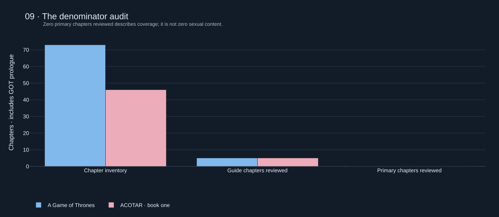

# The Smut Index

**A Game of Thrones (1996), first novel, versus A Court of Thorns and Roses (2015), first novel.**

Research status: **source-discovery pilot; whole-book comparison blocked on lawful texts and annotation.**
The HBO adaptation, later novels, bonus chapters, and audiobooks are outside scope.

## The finding so far

**No defensible winner.** We inventoried 73 GOT chapter units (prologue + 72 chapters)
and 46 ACOTAR chapters. Ten selected chapter summaries yielded 11 original, abstract
event-cluster annotations: four GOT and seven ACOTAR. These are deliberately chosen
research leads, **not comparable whole-book counts**. Selection favored chapters where
content was expected. Do not interpret seven versus four as ACOTAR being smuttier.

Both books have guide-documented sexual-content leads. ACOTAR chapter 27 is one;
GOT chapters 8 and 11 are others. The sources do not establish original prose
explicitness, total sexual word spans, or the frequency of omitted events.

Zero primary-text chapters have been fully annotated. Every whole-book score,
event rate, and severity distribution is therefore unavailable, rather than zero.
The current verdict: **the denominator has entered the chat, and it wants receipts.**

## Explore

- [Interactive Plotly dashboard](reports/dashboard.html): download/open locally; nine panels.
- [Findings](reports/findings.md), [methods](reports/methodology.md), and [coverage](reports/source_coverage.md).
- [Machine-readable results](reports/results.json), [source register](data/sources.json),
  [original annotations](data/events.jsonl), and [chapter inventory](data/chapters.csv).
- [Exportable figures](reports/figures/): Plotly JSON and SVG/PNG exports when available.

The dashboard shows the two chapter maps, provisional category and consent breakdowns,
and a coverage heatmap. Explicitness, overall scores, and weight sensitivity are
deliberately withheld. The heatmap measures **research coverage**, not content intensity.



## Reproduce

From the containing repository:

```bash
cd projects/smut-index
python3.12 -m venv .venv
source .venv/bin/activate
python -m pip install -r requirements.lock
python -m pip install --no-deps -e .
python -m pytest -q
python -m ruff check src tests scripts
python -m smut_index.cli build
```

Open `reports/dashboard.html`. Default HTML embeds its Plotly runtime for offline use;
`build --online` produces a smaller file with a version-pinned CDN script. Charts can export SVG from their
toolbars. To regenerate committed SVG/PNG exports, install a compatible Chrome/Chromium
and set `BROWSER_PATH` if necessary, then run `build --export`.

Building requires no API key, network source fetch, paid model, or novel text. The
committed derived annotations are the frozen input snapshot. `reproduction_manifest.json`
records their hashes and the installed analysis package versions. Do not interpret
reproduction of those annotations as independent validation of them.

## Add lawful text

Provide a personally supplied, lawfully accessible text export of **each first novel**.
No DRM bypassing or unauthorized book downloads are provided. Raw files belong under
ignored `data/private/`. Convert to private JSONL with one **reviewer-defined scene** per
row and fields `work`, `unit_id`, `scene_id`, and `text`. Examples of work IDs are `got`
and `acotar`; chapter IDs are `C00` for the GOT prologue and `C01` onward.

```bash
python -m smut_index.cli detect --input data/private/units.jsonl
```

Candidate output stays private and contains lexical offsets rather than quoted text.
It cannot enter scores automatically. Review candidates **and negative scenes**, resolve
their context against the novel, assign stable event IDs, merge duplicated source
references, record consent/age/word spans/severity, and update the public abstract
annotations. Record scene word counts from that same edition. Only after every scene in
a complete chapter has been reviewed should `primary_reviewed` become true.

The schema rejects unresolved references, impossible intervals, duplicate IDs and attempts
to call a secondary guide primary verification. Scene inventories and full-review flags
are reviewer attestations: software cannot independently prove their completeness.

## The proposed index

For each fully reviewed scene, take the maximum normalized severity within five
components, then calculate:

`100 × (0.35 acts + 0.25 anatomy + 0.20 intimacy + 0.10 language/thoughts + 0.10 intensity)`

Average across the complete scene inventory. Each component lies in [0,1]; the result is
bounded by 0 and 100. This is an **uncalibrated instrument**, not an objectively established
scale. Scene segmentation changes the denominator. Report raw event counts and matched
word-exposure rates alongside it, and compare four alternative weight schemes.

Use separate all-content, consensual, and coercive channels. Nonsexual affection and
nonsexual nudity remain descriptive and do not inflate the proposed sexual-content
score. Unknown consent is never automatically classified as consensual. Minor involvement
is separately recorded; the initial child-marriage annotation is structurally coercive.

See the methods for the intensity component's intentional correlation with the other
components, missingness bounds, false-positive examples, and validation requirements.

## Structure

```text
configs/       Taxonomy, candidate rules, initial and alternative weights
data/          Chapter metadata, source register, original abstract annotations
src/           Ingestion, candidate detection, validation, scoring, reporting
tests/         Integrity and statistical edge-case checks with synthetic fixtures
notebooks/     Exploration of committed annotations, without source prose
reports/       Dashboard, figures, findings, coverage, reproduction manifest
scripts/       Browser screenshot capture
```

The containing repository has a dedicated `.github/workflows/smut-index.yml` check.
No main-branch merge or website deployment is part of this change.

## Limitations and next work

Full novel texts, complete word/scene denominators, independent human annotations, and
held-out novel ground truth are missing. No empirical precision, recall, confidence
calibration, or inter-annotator agreement is claimed. Synthetic test cases only check code.
Next: acquire lawful texts, finalize edition and segmentation choices, annotate a
stratified pilot including negatives, adjudicate errors, complete both novels, then
estimate uncertainty and compare results across weights and definitions.

Code and original annotations are covered by the containing repository's MIT license.
The underlying books, publisher material, and guide prose retain their respective rights;
no full source text is redistributed.
